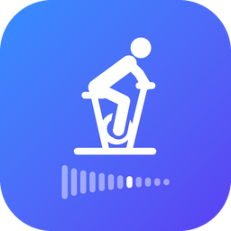

<p align="center"></p>

# TrainerCtrl

An iPhone app that adds virtual shifting to a [Tacx Flux S](https://www.garmin.com/en-US/p/690888/) smart trainer in [Zwift](https://www.zwift.com/).

The phone sits between the trainer and Zwift. It connects to the trainer over Bluetooth and shows up in Zwift as a trainer named **TrainerCtrl**. When you shift, it changes the resistance it sends to the trainer, so the bike feels like it has a full set of gears. The chain stays in one cog the whole ride.

```
Tacx Flux S  ──BLE (FTMS)──▶  TrainerCtrl (iPhone)  ──BLE (FTMS)──▶  Zwift (Mac)
     └───────────── ANT+ power (optional) ─────────────────────────────▲
```

## Features

- Shift with the on-screen + and − buttons or the volume buttons.
- 1× gear presets, or a custom chainring and cassette.
- Two shifting models:
  - **Simple:** each gear adds a fixed grade (1% by default).
  - **Calibrated:** each gear matches the power and cadence a real gear would need. It needs a one-time trainer calibration, which the app guides you through.
- If the trainer stops sending data, Zwift gets zeros. If Zwift disconnects or goes quiet, the trainer eases to a flat road.
- A packet log for each ride, which you can export as CSV from Settings.
- A simulated trainer, so you can test without the real one.

## Requirements

- iPhone with iOS 17 or later
- Xcode 16 or later (Swift 6)
- [Tacx Flux S](https://www.garmin.com/en-US/p/690888/) (or another FTMS trainer) and [Zwift](https://www.zwift.com/) on a Mac

## Dependencies

There are no third-party packages. Everything is built on Apple frameworks and one open Bluetooth standard:

| Dependency | Used for |
|---|---|
| [Bluetooth Fitness Machine Service (FTMS)](https://www.bluetooth.com/specifications/specs/fitness-machine-service-1-0/) | The protocol on both sides: reading the trainer and setting its resistance, and acting as a trainer for Zwift |
| CoreBluetooth | Connecting to the trainer (central) and advertising to Zwift (peripheral) |
| SwiftUI and Observation | All screens and app state |
| ActivityKit, WidgetKit and AppIntents | The lock screen and Dynamic Island widget, and its shift buttons |
| AVFoundation and MediaPlayer | Shifting with the volume buttons |

`TrainerCore` uses only Foundation, so its logic and tests run on a Mac without a phone or trainer.

## Building

Open `App/TrainerCtrl.xcodeproj`, choose your iPhone, and run. The shifting, protocol and calibration logic is in the `TrainerCore` Swift package, which has its own tests:

```sh
cd TrainerCore && swift test
```

## Riding

1. Put the chain in the cog you set under **Settings → Trainer → Real gear** (42×18 by default).
2. Open TrainerCtrl and tap **Start ride**. The app connects to the trainer and shows up in Zwift.
   The first ride connects to the first smart trainer it finds and remembers it. With more than one trainer around, pick yours under **Settings → Trainer → Trainer**.
3. In Zwift, pair **Controllable** and **Cadence** to TrainerCtrl. Pair **Power** to TrainerCtrl too, unless you use ANT+ (below).
4. Keep the app open while you pair. iOS only advertises to Zwift reliably while the app is on screen.
   Once paired, locking the phone or switching apps keeps the trainer and Zwift connected.
   To shift from there, use the − / + buttons on the lock screen, or long-press the Dynamic Island. Volume-button shifting needs the app on screen.
   A ride left in the background with no pedalling for 10 minutes ends on its own, so the app stops using Bluetooth.
5. When you're done, tap **End ride**.

**Events that require a power meter.** Zwift blocks power that comes through a bridge. In those events:
1. Turn off **Send power to Zwift**.
2. In Zwift, pair **Power** to the Flux S directly over ANT+.
3. Keep **Controllable** paired to TrainerCtrl.

## Troubleshooting

**Zwift shows TrainerCtrl as connected, but power and cadence stay at 0, then blank out, while the app still says "Waiting for Zwift to pair".** The Mac is holding stale Bluetooth information about the iPhone. To fix it:
1. Quit Zwift.
2. Turn the Mac's Bluetooth off and on again.
3. Reopen Zwift and pair TrainerCtrl again.

## Layout

| Path | What's there |
|---|---|
| `App/TrainerCtrl/BLE` | The trainer connection, the simulated trainer, and the virtual trainer that Zwift sees |
| `App/TrainerCtrl/Bridge` | `BridgeController`: connects the pieces, stores settings, runs the ride |
| `App/TrainerCtrl/UI` | Screens: home, ride, settings, gears, calibration |
| `App/TrainerCtrlLiveActivity` | The lock screen and Dynamic Island widget extension |
| `App/Shared` | Code in both the app and the extension: the Live Activity's data and the shift action |
| `TrainerCore/Sources/TrainerCore` | FTMS encoding and decoding, bridge logic, gearing, shifting, calibration |
| `Virtual Shifting Bridge for Tacx Flux S — Plan.md` | Design plan and background |

